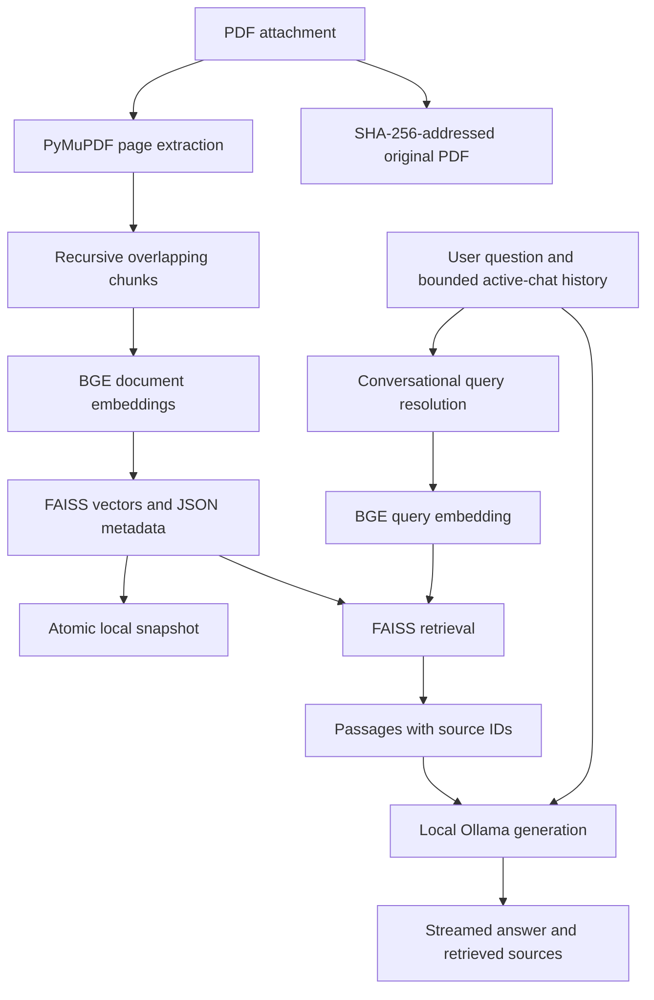

# Offline RAG Knowledge Assistant

## Overview

A local, privacy-oriented document question-answering application using Retrieval-Augmented Generation (RAG). It retrieves relevant PDF passages and supplies them to a local language model, with page references and inspectable source text.

## Features

- Text PDF ingestion with recursive overlapping chunks.
- SHA-256 document identity, duplicate detection, and content-addressed original files.
- Normalized semantic embeddings and exact FAISS similarity search.
- Local conversational question answering with streaming responses.
- Multiple session-based conversations with switching and deletion.
- Original page references, source IDs, similarity scores, and detailed chunk metadata.
- Document management and persistent knowledge-base snapshots.
- Native light/dark appearance and PDF attachments in the chat composer.

## Technology Stack

| Component | Implementation |
|---|---|
| Python | 3.13 recommended; project configuration requires >=3.13 |
| Interface | Streamlit 1.60.0 |
| PDF extraction | PyMuPDF |
| Chunking | LangChain recursive character splitter; 1,000 characters, 200-character overlap, split per page |
| Embeddings | `BAAI/bge-small-en-v1.5`; 384 dimensions; normalized documents and queries |
| Retrieval | FAISS `IndexFlatIP`; inner product of normalized vectors equals cosine similarity |
| Generation | Ollama with local `qwen2.5:3b` |

Conversation-aware retrieval uses up to three completed turns with retrieved passages, bounded to 3,900 history characters. Common follow-ups are resolved into standalone questions with the same local Qwen model; independent questions skip rewriting where recognized. Simple simplification requests reuse the previous resolved query. Unresolved references request clarification. Earlier assistant answers provide context, not authoritative evidence.

## Architecture



## Repository Structure

```text
app.py                    Streamlit UI, conversation state, ingestion and query orchestration
rag.py                    PDF validation/extraction, hashing, original-file storage and cleanup
chunking.py               Recursive character splitting
embeddings.py             Local-only BGE loading, normalized encoding, embedding configuration
vector_store.py           FAISS search, validation, snapshots and document deletion
models.py                 ChunkMetadata and SearchResult dataclasses
llm.py                    Local Ollama client, bounded history, query resolution and streaming
test_llm.py               Synthetic regression tests using unittest and Streamlit AppTest
requirements.txt          Minimal pinned direct Python dependencies for pip
pyproject.toml             Project metadata and uv dependency declarations
uv.lock                   Locked uv environment, including transitive dependencies
.python-version           Python 3.13 selection
.streamlit/config.toml     Light/dark themes, toolbar settings and disabled usage statistics
.gitignore                Exclusions for runtime data, caches and local credentials
RUN.txt                   Portable setup and execution command reference
README.md                 Project documentation

Generated runtime storage (not committed):
uploads/<sha256>.pdf       Retained original PDFs
knowledge_base/snapshot.zip  FAISS index and metadata manifest
```

## Installation

Use standard 64-bit Python 3.13 (macOS 14+ for the pinned Apple silicon binary wheels) and install [Ollama](https://ollama.com/download). Create and activate a virtual environment. Start Ollama (`ollama serve` if necessary) before pulling the generation model, then run:

```sh
python -m pip install -r requirements.txt
ollama pull qwen2.5:3b
python -c "from sentence_transformers import SentenceTransformer; SentenceTransformer('BAAI/bge-small-en-v1.5')"
```

Dependency and model installation require internet access. [RUN.txt](RUN.txt) contains Windows PowerShell and macOS/Linux commands, including virtual-environment activation and loopback-only server configuration.

The existing alternative workflow remains available:

```sh
uv sync --locked
```

The uv lockfile reproduces the established environment. The pip requirements pin direct dependencies; transitive dependencies are resolved by pip. Ollama and model setup are required for either workflow. Newer Python releases and every operating-system/architecture combination are not guaranteed by the project's open-ended Python declaration; binary-wheel availability must be checked.

## Usage

Start Ollama in one terminal and the application in a second, activated terminal:

```sh
python -m streamlit run app.py --server.address 127.0.0.1 --browser.gatherUsageStats false
```

Open `http://127.0.0.1:8501`. Attach a text PDF and submit it, optionally with a question. Selection alone does not ingest files. Uploads are limited to 25 MB, 1,000 pages, and two million extracted characters. Invalid attachments prevent an accompanying question from being answered; duplicates reuse existing indexed content.

Ask questions or conversational follow-ups. Open a retrieved-passages chip to inspect each chunk and its filename, original page, full document hash, derived `document_id:chunk_index`, similarity score, and original text. The resolved retrieval query is available separately. Retrieved passages are not automatically verified claim-level citations, and similarity scores are not confidence probabilities.

Use **New Chat** or the sidebar history to manage conversations. Open **Knowledge base** to delete a document from shared storage; conversations whose answers retrieved it are removed to avoid retaining stale excerpts. New Chat and conversation deletion do not delete documents. **Settings** contains top-k and cached local-model status. The upper-right menu selects appearance.

## Data Storage

Storage paths are anchored to the application directory. Original PDF bytes determine a SHA-256 document ID and are stored as `uploads/<sha256>.pdf`; display filenames are metadata only. Identical bytes are duplicates even under a different filename; different bytes can share a display name.

`knowledge_base/snapshot.zip` contains native FAISS vectors and a JSON manifest with chunk metadata, format version, embedding configuration, and index checksum. A complete temporary archive is flushed, fsynced, and published through one same-directory atomic replacement. Invalid or incompatible snapshots fail closed rather than silently resetting. This is trusted local storage, not authenticated or encrypted storage; keep backups.

Index deletion is published before matching originals are removed. Cleanup failures are reported. Original-file operations and snapshot publication are not one transaction, so abrupt termination can leave orphan PDFs. Directory fsync and automatic power-loss recovery are not implemented. Legacy `faiss.index` / `metadata.json` pairs are preserved but block startup without a new snapshot: back up both storage directories, move the legacy knowledge base aside, and re-ingest verified original PDFs. No automatic migration occurs.

## Offline Operation

After dependencies and both models are installed, the application is designed to operate locally without external services. BGE uses local-only loading. Ollama requests use `127.0.0.1:11434`, ignore environment proxies, and request a ten-minute model keep-alive. RUN.txt disables Ollama cloud features; Streamlit configuration disables usage statistics. Keep both servers on loopback and local networking available.

Questions are limited to 2,000 characters and retrieved context to 12,000 characters. Generation requests an 8,192-token context window and up to 512 output tokens, with a 120-second network timeout. Character limits are not exact token budgets. Initial token latency and model residency depend on available memory and local hardware.

## Limitations

- Scanned/image-only and locked PDFs are unsupported; no OCR or table-layout reconstruction is provided.
- Extraction, chunk boundaries, finite embedding input length, and similarity search affect retrieval quality. There is no relevance threshold, reranker, or automatic answer verification.
- Answers and references require review. Prompting cannot eliminate hallucinations or document prompt injection; reference resolution uses conservative English patterns and can request clarification.
- Deployment assumes one local user/session mutating the knowledge base. There is no authentication, multi-user isolation, encryption, or secure-erasure guarantee.
- Conversations exist only in Streamlit server memory for the active browser session and may disappear after session loss or restart. Long-range conversation memory and model revision pinning are not implemented.
- Some visual adjustments use semantic Streamlit selectors and should be rechecked after upgrades.

## Testing

```sh
python -B -m unittest -v test_llm
```

Tests use synthetic PDFs, temporary storage, real PyMuPDF/BGE/FAISS, and Streamlit AppTest. They cover ingestion failures, page references, duplicates, search, deletion, snapshot corruption/publication failures, conversation state and resolution, and streaming/error handling. BGE artifacts must already be cached. Ollama responses are simulated in the regression suite; live generation and browser appearance require separate checks. AppTest attachment cases supply the native submission value because its chat attachment driver is unavailable. Importing the test module does not run inference.
